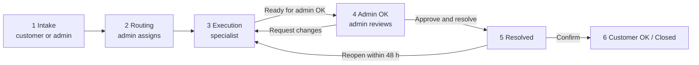
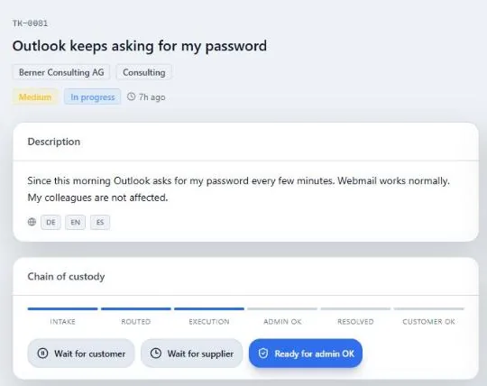
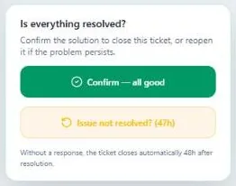

# HelpDesk AI

Enterprise-oriented, multilingual support operations for Swiss SMEs. HelpDesk AI combines ticket ownership, agent queues, SLA workflows, notifications and human-reviewed AI assistance in one Next.js application.

> Status: deployed with demo data and suitable for controlled demos. Production use for a real customer still requires staging migration verification and authenticated E2E coverage (see the release checklist).

     

**Live demo:** https://ticket-system-sigma-pink.vercel.app (demo data, app in development)

## What it does

HelpDesk AI is the ticket system an IT service provider uses to serve its business customers. Customers report issues in a portal, an administrator routes each ticket to the right specialist, the specialist works it, a second person approves the fix, and the customer gives the final confirmation. Every hand-off is visible as a **chain of custody** on the ticket.



### Roles

| Role | What they do | What they see |
| --- | --- | --- |
| Customer | Opens tickets, replies, confirms or reopens | Only their own tickets; never internal notes or triage data |
| Specialist (agent) | Starts work, replies, writes internal notes, reports work as done | Only tickets assigned to them; cannot self-assign |
| Manager | Oversight and analytics | Organization, read-only |
| Administrator | Files tickets for customers, assigns, approves or returns work, force-closes, manages users | Whole organization |

### The ticket lifecycle in detail

1. **Intake.** A customer opens a ticket in the portal (category, priority, summary, description), or an administrator files it on the customer's behalf with **Ticket for Customer**. The ticket gets a `TK-0000` reference and its SLA deadlines (first response and resolution) start immediately.
2. **Routing.** When AI triage is available, the ticket is classified and routed to an online specialist with a matching specialty or team, balanced by active workload. Otherwise it waits in the administrator's intake queue. Only administrators assign or reassign; the app warns when the chosen specialist is offline.
3. **Execution.** The assigned specialist clicks **Start work** (status *In progress*). From there they can mark **Wait for customer** or **Wait for supplier** (tracked as separate states), reply to the customer, or add an **internal note** that stays inside the team. The first public reply records the SLA first response.
4. **Admin OK.** The specialist clicks **Ready for admin OK** and confirms. Execution controls lock until an administrator decides: **Approve and resolve** or **Request changes** (back to *In progress*). A ticket cannot be resolved without an approved review.
5. **Resolved.** The customer is notified and sees **Is everything resolved?**
6. **Customer OK.** The customer clicks **Confirm — all good** (ticket *Closed*) or reopens it within 48 hours. Without an answer the daily job closes it automatically. A closed ticket stays closed: the customer is pointed to **New ticket**.





### SLA tracking

- Each ticket shows an **SLA Deadline** card with a response and a resolution target.
- While a target is open it counts down and turns **At risk** when 1 hour or less, or at most 25 % of the window, remains.
- Once met, it shows **Responded** / **Resolved on time** (or late) with the time, and the header reads **SLA met** or **Breached**. Nothing keeps counting after the fact.
- All times are shown in Swiss time (`Europe/Zurich`).

### AI assistance (optional, human-reviewed)

- **Triage:** suggests category, priority, sentiment and language for staff.
- **Suggested replies** for specialists; a human always sends the message.
- **Customer assistant** that answers while no specialist is online.
- **Translation** of messages between DE, EN and ES.
- When the AI provider is unavailable the app says so plainly ("AI triage unavailable — manual review required", "The assistant is not available right now. A specialist will answer your ticket.") and the workflow continues without it. Provider errors never reach the UI; they stay in server logs.

### Administration

- **Admin Panel:** queue with workflow tabs (New, Assigned, In progress, Waiting, Ready for OK, Processed, Trash), filters, inline assignment and review shortcuts.
- **User manual** at `/admin/manual` (administrators only): the full lifecycle step by step with screenshots, in DE, EN and ES.
- User and customer management, dashboards, analytics and an operations console.
- **Force close** is administrator-only, requires a reason (at least 10 characters) and is written to the audit log.
- Cleanup is a recoverable soft delete; operational history is never hard-deleted from the dashboard.

### Daily SLA brief by email

The companion project [`vidal-helpdesk-mcp`](https://github.com/vidal-renao/vidal-helpdesk-mcp) reads this database (read-only, organization-scoped) and sends a daily SLA brief through Resend:

- compliance for tickets resolved in the last 7 days
- tickets breached in the queue
- unowned tickets
- high-priority risks
- tickets waiting for admin approval
- per-company breakdown

The same project exposes the helpdesk as MCP tools for AI agents.

## Security model

| Actor | Ticket scope |
| --- | --- |
| Customer | Own tickets only (`created_by`) |
| Agent | Assigned tickets only |
| Manager | Read-only organization oversight |
| Admin | Organization tickets, routing, approval, cleanup and configuration |

- Identity, role and organization are derived server-side from Supabase Auth and profiles. The server never trusts tenant or role data sent by the client.
- Row-level security on every table with user data. Every service-role query carries an explicit tenant or owner predicate.
- Internal notes are filtered on the server for non-staff viewers, so they never reach a customer's browser.
- Database triggers enforce rules the UI also enforces:
  - customers cannot change protected ticket fields
  - customers cannot comment on closed tickets (SQLSTATE 23514)
- Audit events for critical operations; secrets fail closed.
- PII minimisation before AI calls.
- These are technical controls, not a legal certification (Swiss nDSG compliance requires a separate assessment).

## Stack

- Next.js 15 App Router, React 19 and strict TypeScript.
- Tailwind CSS 4 with a semantic control-room design system.
- Supabase Auth, PostgreSQL and RLS.
- next-intl for DE/EN/ES.
- Vitest (270+ tests), ESLint (zero warnings), pgTAP database tests and GitHub Actions.
- Vercel Functions/Cron, Anthropic, optional OpenAI and Resend.

## Repository

| Path | Responsibility |
| --- | --- |
| `app/[locale]/` | Public, authentication and protected application routes |
| `app/api/` | HTTP endpoints, cron and integrations |
| `app/actions/` | Authenticated server mutations |
| `components/` | Domain and shared UI |
| `lib/` | Authorization, lifecycle, SLA, AI and infrastructure clients |
| `tests/` | Security and domain regression tests |
| `docs/` | Schema references and forward migrations |
| `.agents/skills/` | Project-local agent skills, including frontend design |

Read [ARCHITECTURE.md](./ARCHITECTURE.md), [DOMAIN.md](./DOMAIN.md), [SECURITY.md](./SECURITY.md) and [SDD.md](./SDD.md) before changing data or authorization flows.

## Local setup

Requirements: Node.js 24, a Supabase project and the required provider credentials.

```bash
npm ci
cp .env.local.example .env.local
npm run dev
```

Key variables:

| Variable | Purpose |
| --- | --- |
| `NEXT_PUBLIC_SUPABASE_URL` | Supabase project URL |
| `NEXT_PUBLIC_SUPABASE_ANON_KEY` | Browser/session key protected by RLS |
| `SUPABASE_SERVICE_ROLE_KEY` | Server-only privileged operations |
| `NEXT_PUBLIC_APP_URL` | Canonical application URL |
| `NEXT_PUBLIC_CONTACT_EMAIL` | Public demo/contact CTA |
| `ANTHROPIC_API_KEY` | Triage, translation and reply suggestions |
| `OPENAI_API_KEY` | Optional RAG embeddings |
| `CRON_SECRET` | Fail-closed SLA cron authentication |
| `EMAIL_INGEST_SECRET` | Fail-closed inbound-email authentication |
| `SETUP_SECRET` | Exceptional setup endpoint authentication |

Secrets for cron, email ingestion and setup must be distinct random values of at least 32 characters.

## Quality gates

```bash
npm run check
npm run build
npm audit --audit-level=high
```

`npm run check` enforces zero-warning lint, strict typecheck and all unit tests. CI runs the same checks from a deterministic `npm ci` install.

## Database

Repository SQL files describe an ordered bootstrap/hardening path but do not prove the deployed schema. Verify the Supabase migration history before promotion:

1. `docs/migration_v1_final.sql`
2. `docs/migration_schema_consistency.sql`
3. `docs/migration_phase1_routing.sql`
4. `docs/migration_rls_profiles_fix.sql`
5. `docs/migration_security_hardening.sql`
6. `docs/rag_migration.sql` only when RAG is enabled

Never edit a historical migration to represent a production change. Add an idempotent forward migration with rollback notes and test it against two tenants.

## Release checklist

1. Apply and verify migrations in staging.
2. Test two organizations and all four roles against RLS.
3. Run customer, agent and admin authenticated E2E flows.
4. Verify cron/webhook secrets and provider failure behavior.
5. Confirm retention, DPA, provider region and incident-response operations.
6. Measure accessibility, Core Web Vitals and bundle budgets; publish only measured results.

See [ROADMAP.md](./ROADMAP.md) for non-implemented work and [CHANGELOG.md](./CHANGELOG.md) for delivered changes.

---

© VIDAL ECOSYSTEM · Basel, Switzerland
